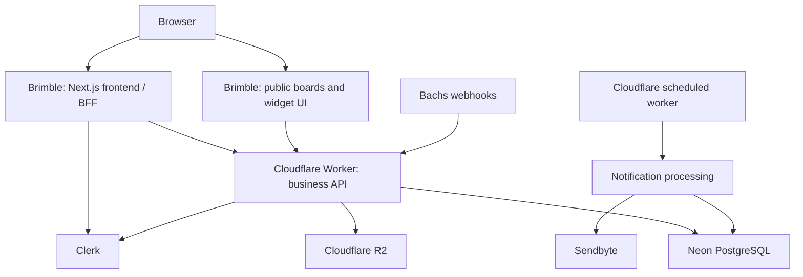

# Cloudflare backend + Brimble frontend

Researched 10 November 2026. Cloudflare is the user-selected backend target. Brimble is a compatible frontend candidate, based on its documented Next.js web-service and static-site support; Ent has not yet been deployed there.

## Compatibility verdict

| Surface | Brimble deployment | Required work |
| --- | --- | --- |
| Landing, pricing, Privacy, Terms | Static site, or routes within the Next.js web service | A separate static deployment needs an isolated marketing build, public assets, static-compatible image handling and auth links pointing to the app origin. |
| Dashboard, auth, onboarding, public boards, widget UI | Next.js **web service** | Retain Next.js SSR/RSC, middleware/proxy and Server Actions as a frontend/BFF layer. Move business/data operations behind the Cloudflare API. This is a paid Brimble service type. |
| Business API, billing webhook, notification worker | Cloudflare Workers | Expose authenticated HTTP endpoints around existing services; verify Clerk identity, workspace authorization, guest activity credentials, validation, rate limits and idempotency on the Worker. |
| Database | Keep Neon PostgreSQL | Adapt connection lifetime for Workers; evaluate Hyperdrive. Keep Drizzle transactions and existing tenant constraints. |
| Upload storage | Keep Cloudflare R2 | Keep private-object access checks and upload validation; never ship R2 secrets to the frontend. |

## Why this is not a hosting-only switch

The current app has 32 exported action functions across nine server-action modules. The dashboard layout also loads identity, workspaces and billing summaries on the server; public layouts load workspace configuration. `src/proxy.ts` performs Clerk and tenant routing. Root providers and private routes prevent exporting the whole repository as static assets.

Server Actions are coupled to their Next.js build and endpoint. Deploying their source separately on a Worker does not make existing frontend imports invoke a remote backend. Explicit HTTP contracts and an authenticated client/BFF boundary are needed. The Brimble frontend may still run a Next.js server while authoritative business logic and database access move to Cloudflare.

## Intended topology

Domain names remain to be assigned. Keep marketing, app, API, widget installation URL, Clerk redirect origins and Bachs webhook/return destinations consistent. Workspace wildcard domains need their own routing/TLS checks on the frontend host. Do not change DNS until the preview deployment and authentication flows pass.

## Migration sequence

1. Build an isolated Workers compatibility proof for database transactions, Clerk verification, Bachs signature verification and R2 access before moving production traffic.
2. Define typed HTTP contracts and shared validation. Port auth/workspace resolution first, then boards and settings, feedback/replies/votes/tags, uploads, notifications, and billing. Reuse existing domain services and tests rather than maintaining two independent implementations.
3. Turn existing Next.js actions into thin frontend/BFF calls. Forward verified user credentials to the API and authorize again at the backend. Browser-to-API calls need exact allowed origins and appropriate token handling; never wildcard credentialed CORS or expose a shared server secret in browser bundles.
4. Run the current Next.js build as a Brimble web service, binding to its assigned PORT on 0.0.0.0. Keep the static marketing routes in that service initially; a separate static marketing project is optional.
5. Add the Cloudflare scheduled notification worker and move the signed billing webhook endpoint. Keep sandbox/live resources separate. Verify receipt, inbox delivery, cancellation and renewal end to end.
6. Preview-test SSR streaming/cache behavior, deploy-version consistency, auth redirects, tenant routing, widget embedding, retries and production builds. Then provision final domains and secrets and switch traffic.

## Brimble settings to verify in preview

- Web service: Node.js runtime, `npm ci`, `npm run build`, `npm start` (or the matching standalone output/start command). Avoid a root Dockerfile accidentally overriding framework detection.
- Static site: a build that actually emits `out/` (Next static export) or another real static asset directory. `.next/` is not a static website output.
- Full Next.js requires a paid Brimble service. Its documented static hosting mode cannot run auth middleware, Server Actions or runtime rendering.
- Next.js 16.4.4 and our exact caching/streaming/proxy behavior need a real preview verification; framework support alone is not a completed compatibility test.

## Sources

- [Brimble supported frameworks](https://paper.brimble.io/projects/frameworks): Next.js server and export modes, commands and runtime selection.
- [Brimble service types](https://paper.brimble.io/projects/service-types): static versus web runtime, required bind address/port, paid web services.
- [Brimble config reference](https://paper.brimble.io/config-as-code/reference): build/start/output/root configuration.
- [Cloudflare OpenNext feature support](https://developers.cloudflare.com/workers/framework-guides/web-apps/opennext/): alternative whole-app deployment; compatibility review remains necessary, including Node.js middleware limitations.
- [Cloudflare Hyperdrive with pg](https://developers.cloudflare.com/hyperdrive/examples/connect-to-postgres/postgres-drivers-and-libraries/node-postgres/): Workers-compatible PostgreSQL connection path.
- Installed Next.js 16.4.4 static-export and deployment guides: static export excludes server-dependent features.

No provider resources or DNS changes were made by this research. No complete API migration or hosting compatibility test is claimed.
